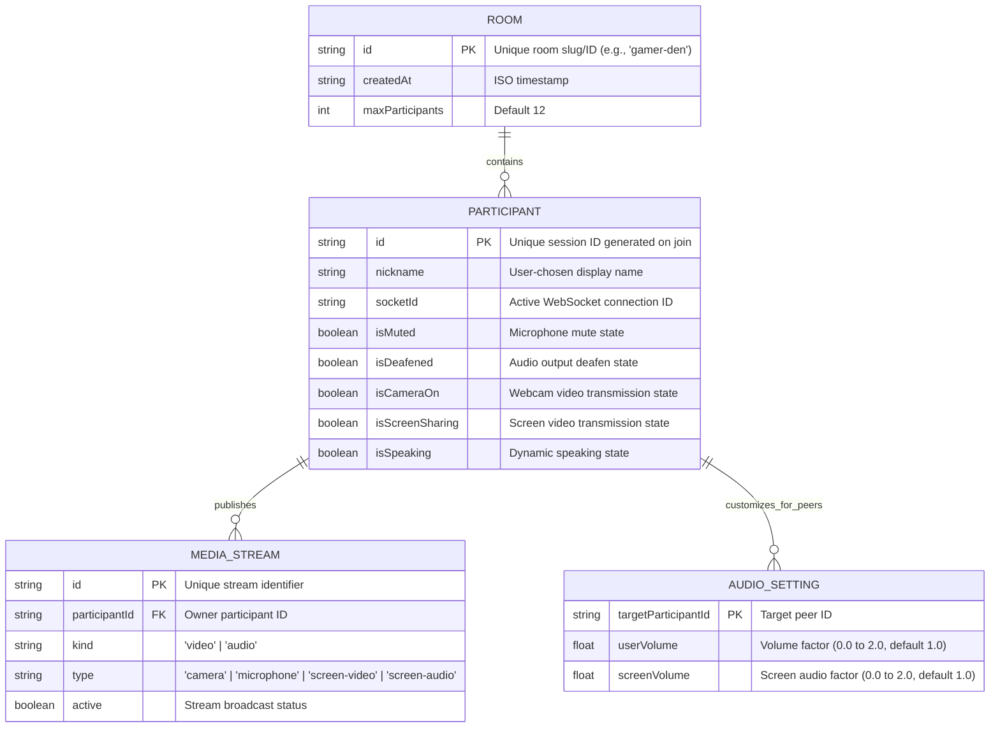

# Phase 1 Data Model: Self-Hosted Voice & Screen Sharing Calls

## Entities & Relationships

---

## Entity Definitions

### 1. Room
Represents an isolated voice and screen-sharing channel on the self-hosted server.
- **Fields**:
  - `id`: `string` (alphanumeric slug or UUID, e.g., `"general"`, `"call-123"`).
  - `createdAt`: `number` (timestamp).
  - `participants`: `Map<string, Participant>` (in-memory map of active participants).
- **Rules**:
  - Rooms exist in memory on the signaling server while at least 1 participant is connected.
  - Automatically cleaned up when the last participant disconnects.
  - No database or disk persistence required for temporary call rooms.

### 2. Participant
Represents an active peer connected to a Room.
- **Fields**:
  - `id`: `string` (unique client session UUID).
  - `nickname`: `string` (1 to 32 characters, trimmed).
  - `socketId`: `string` (WebSocket identifier).
  - `isMuted`: `boolean` (default `false`).
  - `isDeafened`: `boolean` (default `false`).
  - `isCameraOn`: `boolean` (default `false`).
  - `isScreenSharing`: `boolean` (default `false`).
  - `screenSourceType`: `'monitor' | 'window' | null` (indicates source type of active share).
  - `hasScreenAudio`: `boolean` (indicates whether screen share includes audio track).
  - `isSpeaking`: `boolean` (real-time voice activity state).
- **State Transitions**:
  - `CONNECTED` → joins room with `id` and `nickname`.
  - `SPEAKING_ACTIVE` / `SPEAKING_IDLE` → triggered by local VAD / `AnalyserNode`.
  - `STREAMING_STARTED` → when `getDisplayMedia` successfully acquires tracks.
  - `DISCONNECTED` → on WebSocket closure or page unload.

### 3. MediaStream Descriptor
Represents a media track broadcasted over WebRTC.
- **Fields**:
  - `streamId`: `string` (WebRTC `MediaStream.id`).
  - `trackId`: `string` (WebRTC `MediaStreamTrack.id`).
  - `kind`: `'audio' | 'video'`.
  - `origin`: `'microphone' | 'camera' | 'screen' | 'system-audio'`.
  - `participantId`: `string`.

### 4. Local Audio Mixer State
Maintained on each viewer's client inside the Web Audio API context.
- **Fields**:
  - `peerVolumes`: `Record<string, number>` (mapped to `GainNode.gain.value`, range `0.0` to `2.0`).
  - `screenVolumes`: `Record<string, number>` (mapped to screen audio `GainNode.gain.value`, range `0.0` to `2.0`).
  - `isDeafened`: `boolean` (mutes all incoming audio nodes when `true`).
